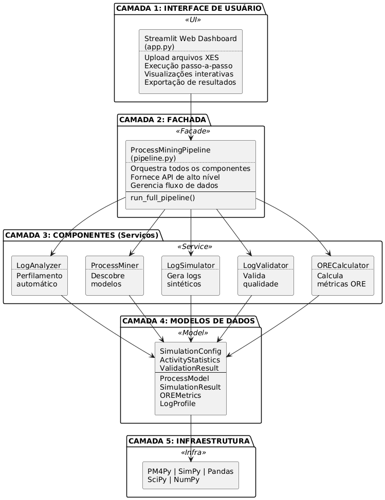

# Simulation model generator for short-term decision making using process mining

LaTeX source of my undergraduate thesis (TCC) in Computer Engineering at PUCPR, Curitiba, 2025, advised by Prof. Dr. Edson Emílio Scalabrin. The thesis is written in Portuguese: *Desenvolvimento de gerador de modelos de simulação para tomada de decisão no curto prazo usando process mining*.

**[Read the PDF](tcc.pdf)** · Code: [Sim2Log-core](https://github.com/viniciusbregoli/Sim2Log-core)

## Summary

Building a simulation model of a process by hand takes time and expertise. This work generates one automatically from an event log (XES), so a manager can test short-term alternatives, such as surgical center scheduling, without modelling the process first.

The prototype, a Streamlit web app, does five things:

- **Log analysis:** profiles the input log (cases, activities, variants, durations).
- **Process mining:** discovers the process model (Petri net and process tree) with the Inductive Miner.
- **Simulation:** runs a discrete-event simulation of the discovered model and writes a synthetic log.
- **Validation:** compares the original and synthetic logs (variants, activity and duration distributions, Kolmogorov-Smirnov tests).
- **ORE indicators:** computes Operating Room Effectiveness metrics.

It was validated with real surgical scheduling data from a surgical center.



**Stack:** Python, PM4Py, SimPy, Pandas, SciPy, Streamlit. The thesis uses abnTeX2 for the Brazilian ABNT format.

## Build

Needs a TeX distribution with abnTeX2 (TeX Live or MacTeX).

```sh
./compile.sh   # pdflatex, bibtex, then two more pdflatex passes; writes tcc.pdf
```

| File | Content |
|---|---|
| `tcc.tex` | Main document and metadata |
| `pretextual.tex` | Abstract (Portuguese and English) and front matter |
| `cap_*.tex` | Chapters: introduction, background, methodology, development, conclusion |
| `postextual.tex` | Post-textual part: the bibliography |
| `referencias.bib` | Bibliography entries |
| `figuras/` | Diagrams and figures |
